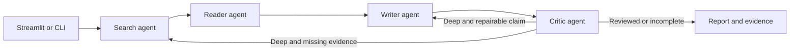

# ResearchRelay

ResearchRelay is a Streamlit application for cited web research. Four LangChain agents plan searches, select evidence, write a report, and check its claims. LangGraph coordinates their state, routes follow-up work, and retains a draft when a later stage fails.

## Run locally

Use Python 3.12 for local setup. On Windows, select it explicitly to use the tested interpreter and its prebuilt dependency wheels.

```powershell
py -3.12 -m venv venv
.\venv\Scripts\python.exe -m pip install --only-binary=:all: -r requirements.txt
.\venv\Scripts\python.exe -m streamlit run app.py
```

On macOS or Linux, use Python 3.12 to create the environment.

```bash
python3.12 -m venv .venv
# Activate .venv for your shell, then run:
python -m pip install -r requirements.txt
python -m streamlit run app.py
```

Use a [Tavily free account](https://docs.tavily.com/documentation/api-credits) and at least one inference provider. Put these variables in an untracked local .env file or in Streamlit Community Cloud's Secrets settings.

```dotenv
TAVILY_API_KEY=...
GROQ_API_KEY=...
LLM_PROVIDER=groq
```

For Streamlit Secrets, put the same keys at the top level in TOML and quote the values. Community Cloud uses app.py as the entry point and requirements.txt for dependencies. Keep provider accounts on unbilled plans. API keys generally cannot tell the app whether billing has been enabled on the account.

The pipeline also runs from the CLI.

```bash
python pipeline.py --mode deep "How do LFP and sodium-ion batteries compare for grid storage?"
python -m unittest -v
```

## How the agents work



| Role | Decision | Tools and output |
| --- | --- | --- |
| Search | Identify the facets of the question and plan distinct searches. On a follow-up, focus on the specific evidence gap. | Tavily basic search, canonical-URL deduplication, source candidates with stable IDs. |
| Reader | Select the excerpts that support each facet, including relevant disagreements or gaps. | Bounded public-page retrieval, passage ranking, and exact quote validation against retrieved content. |
| Writer | Synthesize the evidence and qualify claims and uncertainty. | A streamed Markdown draft citing evidence inline as [S1], [S2], and so on. |
| Critic | Compare the draft's claims and citations with their supporting excerpts. | Structured findings plus deterministic checks for missing, unknown, or outside citations. |

LangChain provides the model adapters, prompt templates and structured response parsing. LangGraph stores the query plan, sources, evidence, draft, findings and counters in typed state. Each run has an in-memory checkpoint and can retry a failed stage once while its Streamlit session remains active. Process restarts and browser-session resets clear history and checkpoints.

The system ranks Tavily results by relevance and publisher diversity, extracts the useful parts of selected HTML pages, and preserves original URLs and excerpts for citation review. It also supports snippet-only evidence when a page is unavailable and labels that evidence in the UI. Page content is treated as untrusted data. The reader validates public addresses on each redirect, pins the connection to a validated address, and limits body size and concurrency. Successful public page reads use a bounded 15-minute cache. Search results are cached within the run.

## Research modes

| Budget | Fast Research | Deep Research |
| --- | ---: | ---: |
| Search requests before a manual retry | Up to 2 | Up to 4 |
| Candidate source limit | 8 | 16 |
| Page fetch slots | 3 | 8 |
| Estimated evidence token budget | 2,500 | 4,500 |
| Model calls on a clean pass | 4 | 4 |
| Automated feedback cycles | 0 | 1 |
| Network model attempts, including fallbacks | Up to 7 | Up to 13 |
| Time budget per attempt | 50 seconds | 105 seconds |

Fast visits all four roles once and exposes any unresolved issues. Deep reserves retrieval capacity for a potential follow-up. A Critic finding can send it back to Search for missing evidence or to Writer for a targeted repair. A full evidence revisit adds up to four primary model calls. A revision adds up to two. Both go through the Critic again. A manual retry can use one extra basic search request and remains within the model attempt budget. Token estimates and deadlines are app-side budgeting aids. Provider usage, when available, appears separately in the run trace.

## Model routing

| Provider | Setup | Route |
| --- | --- | --- |
| [Groq](https://console.groq.com/docs/rate-limits) | GROQ_API_KEY | GPT-OSS 20B for Search, Reader, and Fast writing and review. Deep uses GPT-OSS 120B for writing and Qwen 3.8 27B for structured review so they have separate model allowances. Each can fall back to the other when eligible. |
| [Cloudflare Workers AI](https://developers.cloudflare.com/workers-ai/platform/pricing/) | CLOUDFLARE_ACCOUNT_ID and CLOUDFLARE_API_TOKEN | Optional independent fallback using matching GPT-OSS models. Verify access and capacity under Workers Free. |
| [OpenRouter](https://openrouter.ai/collections/free-models) | OPENROUTER_API_KEY | Optional fallback or the primary route for an existing OpenRouter-only setup. Defaults to google/gemma-4-26b-a4b-it:free. OPENROUTER_MODEL accepts explicit free variants. |
| [Gemini](https://aistudio.google.com/docs/pricing) | GOOGLE_API_KEY or GEMINI_API_KEY | Explicit opt-in with LLM_PROVIDER=gemini or through the fallback list. Defaults to Gemini 3.1 Flash-Lite and 3.8 Flash. GEMINI_MODEL can choose either. Confirm [eligibility and terms](https://aistudio.google.com/docs/terms) for the deployment and audience. |
| [Ollama](https://ollama.com/) | LLM_PROVIDER=ollama and an available local server | OLLAMA_MODEL and OLLAMA_BASE_URL are configurable. Use a model able to return structured responses. |

Set LLM_FALLBACK_PROVIDERS=cloudflare,openrouter to opt into both public fallback routes. Only configured routes are used. If LLM_PROVIDER is unset, auto-selection looks for configured Groq, Cloudflare, then OpenRouter credentials. Gemini and Ollama require explicit selection. Old deployments with obsolete model IDs should update or remove their model overrides.

Tavily uses basic search with auto-escalation disabled. The app enforces per-run ceilings, process-local Tavily and Groq/OpenRouter quotas, and a small concurrency limit. Keep the providers' free-plan limits in place across restarts and instances. When a route is busy, the stage can try another eligible route. If none is available, the run keeps its checkpoint and shows the estimated wait when known. Clicking Retry before that wait expires preserves the retry and does not send a model request.

## Demonstrate the workflow

- Run a Fast comparison and open **Run details**. Look for one Search, Reader, Writer, and Critic stage. Open a cited source to see the actual excerpt and its original URL.
- Run a Deep question with several facets. If the Critic identifies a material gap, the trace explains the transition back to Search. A report issue that can be fixed with existing evidence routes to Writer. The offline Deep fixtures exercise both transitions deterministically.
- To see partial recovery without external calls, run the offline critic-timeout test. It verifies that the original draft is retained and the retry invokes only the Critic.

The offline suite uses real LangGraph and Streamlit AppTest with scripted provider and retrieval responses. For live comparisons, run equivalent questions with free credentials and record startup, first usable source, first draft, final completion, per-stage timings, calls, tokens, and outcome. Judge report coverage and whether cited excerpts support each claim. Keep offline timings separate from live provider or cloud-wake measurements.

### Local comparison against the original revision

With Python 3.12 and Streamlit 1.67, three paired fresh-process AppTest runs measured a median time to first script render of **1.66 s before and 0.68 s after**, including the testing framework import. The median of the warm rerun medians was **16 ms before and 20 ms after**. A matched offline search-and-read fixture used **six model turns before and four in Fast mode**, with one search and one page fetch in both versions. These measurements cover local rendering and scripted orchestration.
