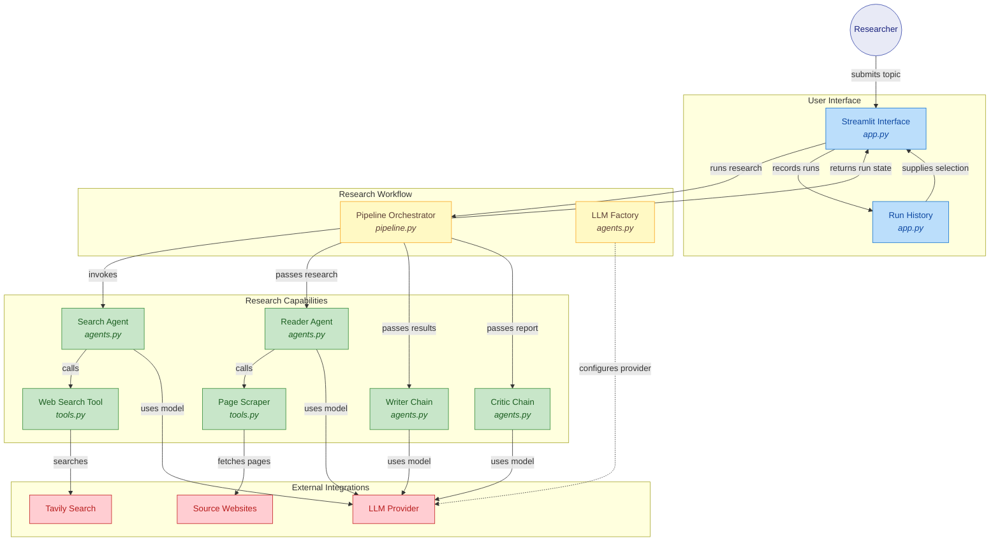

# 🔬 Multi-Agent AI Research System

A modular research automation platform that orchestrates multiple specialized AI agents to conduct end-to-end research workflows — from web search to polished report — with minimal human intervention.

---

## ✨ Overview

The system automates the entire research lifecycle by delegating tasks to four specialized agents that work in sequence:

| Step | Agent | Role |
|------|-------|------|
| 1 | **Search Agent** | Discovers relevant sources via Tavily web search |
| 2 | **Reader Agent** | Scrapes and extracts content from the top-ranked source |
| 3 | **Writer Chain** | Synthesizes findings into a structured research report |
| 4 | **Critic Chain** | Reviews the report for accuracy, coherence, and quality |

A **Streamlit UI** provides an intuitive interface for running research queries, viewing real-time progress, and downloading results.

---

## 🏗️ Architecture



### Data Flow

```
Researcher submits topic
    │
    ▼
┌─────────────────────────────────────┐
│  Streamlit UI  (app.py)             │
│  Form → Progress → Results → Export │
└──────────────┬──────────────────────┘
               │ runs research
               ▼
┌─────────────────────────────────────┐
│  Pipeline Orchestrator (pipeline.py)│
└──────────────┬──────────────────────┘
               │
   ┌───────────┼───────────┬──────────────┐
   ▼           ▼           ▼              ▼
Search      Reader      Writer         Critic
Agent       Agent       Chain          Chain
   │           │           │              │
   ▼           ▼           │              │
web_search  scrape_url     │              │
(Tavily)    (BS4)          │              │
                           ▼              ▼
                      LLM Provider   LLM Provider
                    (OpenRouter / Gemini / Ollama)
```

---

## 🚀 Quick Start

### Prerequisites

- **Python 3.8+**
- **API key** for at least one LLM provider (OpenRouter, Google Gemini, or Ollama)
- **Tavily API key** for web search

### Installation

```bash
# 1. Clone the repository
git clone https://github.com/your-username/Multi_agent_Ai_research_system.git
cd Multi_agent_Ai_research_system

# 2. Create and activate a virtual environment
python -m venv .venv
.venv\Scripts\activate        # Windows
# source .venv/bin/activate   # macOS / Linux

# 3. Install dependencies
pip install -r requirements.txt
```

### Environment Setup

Create a `.env` file in the project root:

```env
# ── LLM Provider (pick one) ──────────────────────────
LLM_PROVIDER=openrouter          # openrouter | gemini | ollama

# OpenRouter (default — free models available)
OPENROUTER_API_KEY=your_key_here
OPENROUTER_MODEL=meta-llama/llama-3.1-8b-instruct:free

# Google Gemini (free tier — 1M tokens/day)
GOOGLE_API_KEY=your_key_here
GEMINI_MODEL=gemini-2.5-flash

# Ollama (local, no key needed — just install & run Ollama)
OLLAMA_MODEL=qwen2.5:0.5b

# ── Web Search ────────────────────────────────────────
TAVILY_API_KEY=your_tavily_key_here
```

### Run the Application

```bash
# Start the Streamlit web interface
python -m streamlit run app.py
```

The app opens automatically at **http://localhost:8501**.

<details>
<summary><b>Alternative run commands</b></summary>

```bash
# Windows — explicit venv path
.venv\Scripts\python.exe -m streamlit run app.py

# Custom port
python -m streamlit run app.py --server.port 8000

# Headless (no browser auto-open)
python -m streamlit run app.py --server.headless true

# Run pipeline directly in terminal (no UI)
python pipeline.py
```
</details>

---

## 🧩 Core Components

### LLM Factory (`agents.py`)

Automatic provider selection with a configurable `LLM_PROVIDER` environment variable:

| Provider | Model | Notes |
|----------|-------|-------|
| **OpenRouter** (default) | `meta-llama/llama-3.1-8b-instruct:free` | Unified gateway, free models available |
| **Google Gemini** | `gemini-2.5-flash` | Free tier: 15 req/min, 1M tokens/day |
| **Ollama** | `qwen2.5:0.5b` | 100% local, no API key needed |

All models run at **temperature 0** for deterministic, reproducible output. The LLM is instantiated lazily — the UI loads even if the API key is missing.

### Agent Layer (`agents.py`)

| Agent | Type | Tool | Input → Output |
|-------|------|------|-----------------|
| **Search Agent** | ReAct (LangGraph) | `web_search` | Topic → 3 ranked results (title, URL, snippet) |
| **Reader Agent** | ReAct (LangGraph) | `scrape_url` | Search results → Clean text from best URL (1500 chars) |
| **Writer Chain** | LCEL Pipeline | — | Research + topic → Structured report (Intro, Findings, Conclusion, Sources) |
| **Critic Chain** | LCEL Pipeline | — | Report → Score/10 + Strengths + Improvements + Verdict |

### Tools Layer (`tools.py`)

| Tool | Provider | Description |
|------|----------|-------------|
| `web_search(query)` | Tavily API | Searches the web, returns 3 results with titles, URLs, and 300-char snippets |
| `scrape_url(url)` | BeautifulSoup | Fetches a page, strips `<script>`, `<style>`, `<nav>`, `<footer>`, returns 1500 chars of clean text |

### Pipeline Orchestrator (`pipeline.py`)

Runs the four agents sequentially, passing state between each step:

```
Search Agent → state['search_results']
    ↓
Reader Agent → state['scraped_content']
    ↓
Writer Chain → state['report']
    ↓
Critic Chain → state['feedback']
    ↓
return state → Streamlit UI
```

### UI Layer (`app.py`)

- **Dark-themed Streamlit** interface with custom CSS
- **Research form** with topic input and pipeline trigger
- **Real-time progress** indicator across all 4 stages
- **Tabbed results**: Report · Critic Feedback · Search Results · Scraped Content
- **Research history** sidebar with quick-access to previous runs
- **Markdown export** — download final reports with one click

---

## 📁 Project Structure

```
.
├── app.py               # Streamlit UI — form, progress, results, history
├── pipeline.py          # Pipeline orchestrator — 4-step sequential workflow
├── agents.py            # Agent definitions & LLM factory (Search, Reader, Writer, Critic)
├── tools.py             # Tool implementations (Tavily web search, BeautifulSoup scraper)
├── requirements.txt     # Python dependencies
├── test_pipeline.py     # Test suite
├── .env                 # API keys (not committed)
└── README.md            # This file
```

---

## 🎯 Features

- **End-to-end automation** — From topic input to polished, reviewed report
- **Multi-provider LLM support** — OpenRouter, Google Gemini, or local Ollama
- **Real-time progress tracking** — Watch each agent complete its work
- **Result transparency** — Inspect raw search results and scraped content
- **Research history** — Revisit and compare previous runs
- **One-click export** — Download reports as Markdown
- **Graceful error handling** — Informative messages for missing keys, network failures, and bad input
- **Lazy initialization** — UI loads instantly; LLM connects only when needed

---

## 📊 Performance

| Metric | Value |
|--------|-------|
| End-to-end runtime | ~30–60 seconds |
| Search results per query | 3 |
| Scrape content limit | 1,500 characters |
| LLM temperature | 0 (deterministic) |
| Execution mode | Sequential (no parallelism) |
| Caching | None (fresh data every run) |

---

## 💡 Use Cases

- **Academic Research** — Literature review and synthesis
- **Technical Discovery** — Explore new technologies and frameworks
- **Business Intelligence** — Market analysis and competitive research
- **News & Trends** — Current events synthesis and summarization
- **Knowledge Work** — Rapid information gathering and organization

---

## 🐛 Troubleshooting

| Problem | Solution |
|---------|----------|
| `ModuleNotFoundError: streamlit` | `pip install streamlit` |
| `API key not found` | Add the correct key to `.env` and restart |
| Port 8501 in use | Use `--server.port 8000` |
| Empty search results | Check internet connection and Tavily API quota |
| Ollama not reachable | Start Ollama and run `ollama pull qwen2.5:0.5b` |

---

## 🔧 Development

### Running Tests

```bash
python -m pytest test_pipeline.py -v
```

### Adding a New Agent

1. Define the agent builder in `agents.py`
2. Add the step in `pipeline.py` → `run_research_pipeline()`
3. Wire the results into the Streamlit UI in `app.py`

### Adding a New Tool

1. Implement the tool function in `tools.py` with the `@tool` decorator
2. Pass it to the agent's `create_agent(tools=[...])` call in `agents.py`

---

## 🚧 Future Enhancements

- Multi-source synthesis — scrape and combine multiple URLs
- Fact verification — cross-check claims across sources
- Domain specialization — custom agents for specific research fields
- Persistent memory — context for follow-up queries
- Advanced export — PDF, JSON, structured data formats
- Batch processing — research multiple topics in sequence
- Caching — store results for repeated queries

---

## 📝 License

[Add your license here]

## 🤝 Contributing

Contributions are welcome! Feel free to open issues or submit pull requests.
